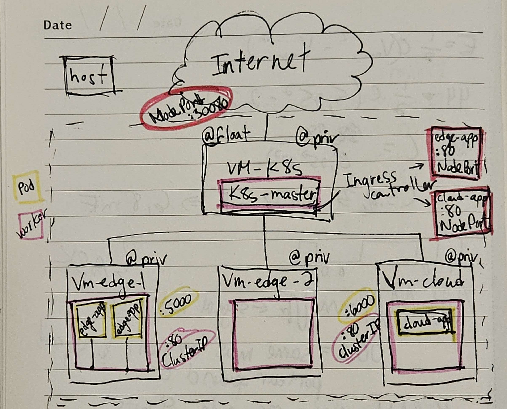

# TP 3

## Étape 1

1. Quel est le rôle de VM-K8s dans l’architecture mise en place ? Quelle est la différence entre
cette machine et les nœuds workers ?

Cette machine sert de machine de gestion pour les autre noeuds. Les noeuds workers vont executer les applications cloud et edge, alors que la machine maitre va gérer l'orchestration des noeuds workers. Il peut déployer les applications, remplacer les applications qui tombent en panne, et optimiser les ressources selon l'utilisation. 

2. Pourquoi avoir attribué les labels "PoP=space_x" aux workers ?

PoP signifie Point of Presence, il représente la localisation géographique d'un noeud. L'objectif d'attribuer les labels "PoP=space_x" aux workers est donc de pouvoir identifier la localisation du véhicule en fonction du noeud qui communique avec celui-ci. Ainsi, si le noeud "PoP=space_1" communique avec le véhicule, on sait que celui-ci se situe dans la zone space_1.

3. Le script d’installation vous a permis d’installer Kubernetes sans exécuter manuellement
toutes les commandes nécessaires. Citez les opérations importantes réalisées par le script
master et expliquez très brièvement en quoi elles sont nécessaires au fonctionnement du
cluster.

Le script fonctionne en 8 étapes:

1- Désactiver le swap.
Selon kubernetes, le swap peut impacter les performances pour les systèmes critiques comme le kubelet.

2- Configuration du réseau.
Kubernetes a besoin de sa propre configuration pour fonctionner correctement.

3- Installation et activation de containerd 
Containerd est le moteur de conteneurisation utilisé par kubernetes.

4- Installation de Kubernetes.
kubelet, kubeadm et kubectl sont installés.

5- Initialisation du cluster.
Le cluster est initialisé avec kubeadm init en utilisant l'ip de la machine actuelle comme maitre.

6- Installation du réseau de pods.
kubectl utilise des fichiers de configuration Calico pour configurer le réseau de pods. Il installe ensuite Traefik.

7- Configuration de kubectl.
Le fichier admin.conf est copié dans ~/.kube/config`

8- Print de la commande pour rejoindre le cluster.

## Étape 2

1. Quel est le rôle d’un Deployment dans Kubernetes ? Pourquoi ne déploie-t-on pas directement
un Pod ?

Un deployment décrit l'état désiré pour un ensemble de pods. Il permet de décrire entre autre le nombre de répliques que nous voulons ainsi que le selecteur pour chaque pod. Kubernetes va ensuite utiliser ce deployment pour assurer l'état de notre cluster. Si un pod tombe en panne, Kubernetes va automatiquement le remplacer par un nouveau pod pour assurer que l'état décrit dans le fichier est toujours respecté. Déployer directement un pod ne permet pas de garantir l'état d'un cluster, et donne plus de chances d'avoir des problèmes de configurations.

2. Quelle est la différence entre "port" et "targetPort" dans un Service ?

"port" est le port exposé par le service qui peut être accédé de l'extérieur. Le "targetPort" est le port sur lequel le pod écoute et qui va recevoir le trafic redirigé par le service.

3. Quelle est la différence entre une ressource Service et une ressource Ingress ? Quel problème chacune permet-elle de résoudre ?

La ressource Ingress permet de diriger le traffic entrant vers un service en suivant des règles définies dans le fichier de ressource Ingress. La ressource Service permet de gérer le traffic interne entre pods et de diriger le traffic vers les pods individuelles. Donc le service Ingress permet de gérer le traffic externe vers les différents services, alors que les services dirigent le traffic interne vers les pods.

4. Dans l’architecture actuelle, on trouve les ports 80, 5000 et 30080. Quel est le rôle de chacun ?

Le port 80 est le port exposé par la chaque pod individuelle. Le port 5000 est le port qui est exposé par notre service, qui va ensuite rediriger le traffic vers les pods au port 80. Finalement, le port 30080 est le port exposé par l'Ingress, qui va être ouvert à l'extérieur et qui va ensuite rediriger notre traffic vers les différents services, dans ce cas vers le port 5000 du service.

## Étape 3

Réalisez un diagramme de l’architecture complète mise en place jusqu’à présent. Faites apparaître :

— les VM et leurs adresses IP
— les Pods et leurs applications conteneurisées
— les adresses IP et ports utilisés par les ressources Kubernetes.

